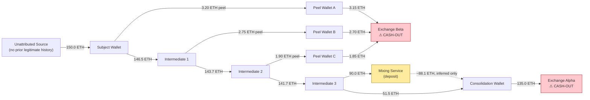

# Investigation Report — Case ONCHAIN-001

**Subject Wallet:** `0xa9491f4c1bf7b0cffbadcba2db8f028e4b3f2867`
**Case Type:** On-chain fund-flow analysis, Ethereum
**Investigation Period Covered:** 2026-04-02 09:02 UTC – 2026-04-03 08:11 UTC (~23 hours)
**Prepared by:** [Your Name], AML Analyst
**Status:** Recommended for SAR filing — see Recommendation

> **Data disclosure:** All wallet addresses and transaction hashes in
> this report are fictional, generated for this portfolio
> demonstration and do not correspond to any real blockchain
> transaction, wallet, exchange, or mixing service. "Exchange Alpha,"
> "Exchange Beta," and "Mixing Service" are generic illustrative
> roles. The investigative methodology and typology analysis are the
> real subject matter of this document.

---

## 1. Summary

On 2026-04-02 at 09:02 UTC, the Subject Wallet received an inbound
transfer of **150.0 ETH** (~$361,500 at the time of transfer) from an
unattributed wallet with no prior on-chain history consistent with
legitimate commercial activity. Within 45 minutes, the Subject Wallet
began moving funds through a multi-hop **peel chain** — a layering
technique in which small amounts are repeatedly split off at each
wallet while the bulk continues onward. Over the following ~23 hours,
the funds passed through three intermediate wallets, partially
through a non-custodial mixing service, and ultimately reached two
centralized exchange deposit addresses.

**This pattern — rapid multi-hop layering, partial mixer use, and
convergence on exchange deposit addresses shortly after receipt of
an unexplained large inbound transfer — is consistent with an
attempt to obscure the origin of funds ahead of cashing out to
fiat or another asset.**

## 2. Fund Flow Narrative

**Hop-by-hop:**

| Hop | Time (UTC) | From → To | Amount (ETH) | Note |
|---|---|---|---|---|
| 1 | 09:02 | Unattributed Source → Subject Wallet | 150.0 | Triggering inbound transfer |
| 2 | 09:47 | Subject Wallet → Peel Wallet A | 3.20 | Peel (45 min after receipt) |
| 3 | 09:49 | Subject Wallet → Intermediate 1 | 146.5 | Bulk continues |
| 4 | 11:15 | Intermediate 1 → Peel Wallet B | 2.75 | Peel |
| 5 | 11:18 | Intermediate 1 → Intermediate 2 | 143.7 | Bulk continues |
| 6 | 14:40 | Intermediate 2 → Peel Wallet C | 1.90 | Peel |
| 7 | 14:44 | Intermediate 2 → Intermediate 3 | 141.7 | Bulk continues |
| 8 | 22:10 | Intermediate 3 → Mixing Service | 90.0 | Trail breaks — mixer |
| 9 | 22:16 | Intermediate 3 → Consolidation Wallet | 51.5 | Direct (non-mixed) path |
| 10 | 03:30 (+1d) | Mixing Service (withdrawal) → Consolidation Wallet | 88.1 | **Inferred only — see §4** |
| 11 | 05:05 (+1d) | Consolidation Wallet → **Exchange Alpha** | 135.0 | Primary cash-out |
| 12 | 08:00 (+1d) | Peel Wallet A → **Exchange Beta** | 3.15 | Secondary cash-out |
| 13 | 08:05 (+1d) | Peel Wallet B → **Exchange Beta** | 2.70 | Secondary cash-out |
| 14 | 08:11 (+1d) | Peel Wallet C → **Exchange Beta** | 1.85 | Secondary cash-out |

## 3. Typologies Identified

**3.1 Peel chain layering.** At each of the first three hops, the
receiving wallet immediately split off a small amount (2–3 ETH, each
under 3% of the case total) to a new, previously unused wallet while
routing the overwhelming majority onward. This is a well-documented
on-chain laundering technique — it creates the appearance of
dispersed, unrelated small transfers while the bulk of value
continues moving as a traceable unit.

**3.2 Rapid layering velocity.** Six of the fourteen transactions
occurred within two hours of the wallet receiving the funds being
moved (see `flag_rapid_succession` in the workbook). A 1–7 minute gap
between receipt and onward transfer, repeated across multiple hops,
is not consistent with manual wallet management and suggests
scripted or automated fund movement.

**3.3 Partial mixing service use.** At hop 8, the largest single
remaining balance (90.0 ETH, 60% of the case total) was sent to a
non-custodial mixing service rather than continuing the direct chain.
See §4 for what this does and does not allow the investigation to
conclude.

**3.4 Exchange-side smurfing.** The three peeled amounts (3.20, 2.75,
and 1.90 ETH — each individually unremarkable) converged on the
**same** Exchange Beta deposit address within six minutes of each
other (08:00–08:11 UTC). Three small, separately-sourced deposits
arriving at one destination address in immediate succession is itself
a pattern worth flagging, even though no single deposit would trigger
attention on its own — this is the on-chain equivalent of structuring
cash deposits to stay under a reporting threshold.

**3.5 Convergence on identifiable cash-out points.** Despite the
layering, 100% of the traceable funds (135.0 + 3.15 + 2.70 + 1.85 =
142.7 of the original 150.0 ETH, net of the amount whose direct link
is broken by the mixer) ultimately reached one of two known exchange
deposit address clusters. Centralized exchanges maintain KYC records
on their depositing customers — this is the point in the chain where
an off-chain legal process (subpoena, production order) could
identify a real-world identity behind the funds.

## 4. Investigative Limitation — Be Honest About the Mixer

This is the most important analytical judgment in the case, and it's
worth stating plainly rather than glossing over: **on-chain data
alone cannot prove that the 88.1 ETH which left the mixing service's
withdrawal address is the same 90.0 ETH that entered its deposit
address.** Mixing services are specifically designed to break that
link. What the investigation *can* document:

- **Amount proximity:** 88.1 ETH is consistent with 90.0 ETH net of a
  roughly 2% mixer fee, which is within the typical range for
  services of this kind.
- **Timing proximity:** the withdrawal occurred approximately 5 hours
  and 20 minutes after the deposit, a plausible dwell time for this
  type of service.
- **Destination proximity:** the withdrawal address sent funds to the
  same Consolidation Wallet that received the non-mixed portion of
  the same case's funds just hours earlier.

Three consistent signals is strong circumstantial support for
treating the two as related — enough to include in a SAR narrative
as an investigative finding — but it is a **correlation, not a
proven on-chain link**, and the report says so explicitly rather than
presenting it with the same certainty as the other, directly
traceable hops. Overstating what blockchain analysis can prove is a
credibility problem the first time a case is challenged; understating
a genuine correlation wastes a real lead. The goal is to state
exactly what the evidence supports — no more, no less.

## 5. Red Flags Summary

| Red Flag | Present? | Evidence |
|---|---|---|
| Large unexplained inbound transfer, no counterparty history | Yes | Hop 1 |
| Rapid onward movement after receipt | Yes | Hops 2, 3, 5, 7, 9, 11 (1–96 min) |
| Peel chain / value-splitting pattern | Yes | Hops 2, 4, 6 |
| Mixing service interaction | Yes | Hops 8, 10 |
| Multiple small deposits converging on one address in quick succession | Yes | Hops 12–14 |
| Ultimate movement to a known exchange deposit address | Yes | Hops 11–14 |

## 6. Recommendation

1. **File a SAR** referencing this fund-flow analysis, naming the
   Subject Wallet, all intermediate/peel wallets, and both exchange
   deposit address clusters identified.
2. **Refer Exchange Alpha and Exchange Beta deposit addresses** to
   the appropriate law enforcement liaison for a production
   order/subpoena to identify the account holder(s) who deposited
   these funds — this is the highest-value next step, since it is
   the point where on-chain analysis alone cannot go further.
3. **Flag the mixer correlation as a supporting lead, not a proven
   fact**, in the SAR narrative, per §4.
4. **Monitor the exchange deposit addresses** for continued activity,
   since exchange address clusters are frequently reused across
   unrelated cases and may surface again.

---

*This report and its underlying data (Address_Book, Raw_Transactions,
Fund_Flow_Analysis) are provided in `Onchain_Investigation_Workbook.xlsx`
in this repository, along with standalone CSV exports in `data/`.*
