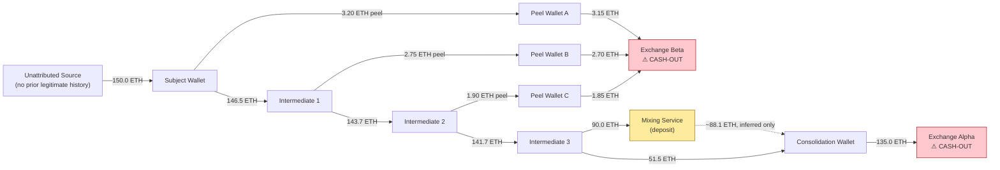
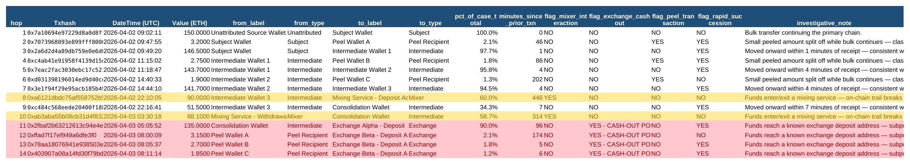
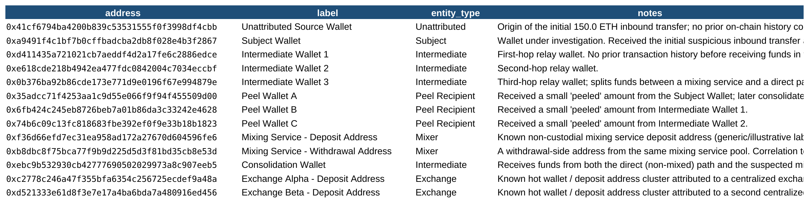

# On-Chain Transaction Investigation — Suspicious Crypto Wallet Fund-Flow Analysis

A no-code blockchain forensics workbook tracing a suspicious 150 ETH
inbound transfer through a **peel chain** — the classic on-chain
layering pattern where a wallet repeatedly splits off small amounts
while the bulk of funds continues moving toward a cash-out point.
Built entirely in Excel formulas, structured around **Etherscan's
real transaction export schema**. No Python, no SQL, no VBA.

This is the sixth project in an AML/KYC portfolio series, and the
first focused specifically on crypto-asset investigation — connecting
traditional fund-flow analysis technique to Ethereum/on-chain data.

## ⚠️ About the data — read this first

Every wallet address and transaction hash in this project is
**entirely fictional** — deterministically generated to look like
real hex values, but none correspond to any real blockchain
transaction, wallet, exchange, or mixing service. "Exchange Alpha,"
"Exchange Beta," and "Mixing Service" are generic illustrative roles,
not references to any specific real protocol or company.

What **is** real: the CSV column structure in `Raw_Transactions`
exactly mirrors Etherscan's actual "Export Transactions" feature
(`Txhash, Blockno, DateTime (UTC), From, To, Value (ETH), TxnFee
(ETH), Historical $Price/Eth, Value (USD), Method`). A real
investigation starts by exporting exactly this CSV from
[etherscan.io](https://etherscan.io) for the address in question —
the analytical approach in this workbook drops directly onto that
real export with no restructuring needed.

## What's in this repo

```
Onchain_Investigation_Workbook.xlsx   ← the main workbook (open this)
Investigation_Report.md               ← the formal case memo (read this)
README.md
data/
  address_book.csv                    ← wallet roles, standalone CSV
  raw_transactions.csv                ← the 14-transaction case file, standalone CSV
  fund_flow_analysis_output.csv       ← computed typology flags, exported as CSV
screenshots/
  address_book.png
  fund_flow_analysis.png
```

**Start with `Investigation_Report.md`** — it's written as an actual
case memo, the kind that supports a SAR filing, not a technical
readme. The workbook is the supporting evidence behind it.

## The case, in one diagram



150 ETH goes in on the left. Within 23 hours, it's split across 14
transactions and 13 wallets, and 95% of it lands at one of two
exchange deposit addresses on the right — the point where an
off-chain subpoena could identify who actually controls the funds.

## Workbook structure

| Tab | Purpose |
|---|---|
| `README` | Methodology (same content as this file, for anyone who only opens the workbook) |
| `Address_Book` | Every wallet in the case and what role it plays |
| `Raw_Transactions` | The 14-transaction case file, in Etherscan's own export format |
| `Fund_Flow_Analysis` | The investigative engine — every transaction enriched with counterparty labels and formula-driven typology flags |

Open `Fund_Flow_Analysis` and click any cell to see the live formula
behind each flag — nothing is hardcoded.

## Typologies flagged

- **Peel chain** — a small amount split off at each hop while the
  bulk continues onward.
- **Mixer interaction** — funds sent to a non-custodial mixing
  service, which breaks deterministic on-chain traceability past
  that point.
- **Exchange cash-out** — funds reaching a known exchange deposit
  address, the point where an off-chain subpoena could identify a
  real-world identity.
- **Rapid layering velocity** — hops occurring within minutes of
  receipt, consistent with scripted/automated fund movement rather
  than ordinary wallet activity.
- **Exchange-side smurfing** — three separately-peeled amounts
  converging on the *same* exchange deposit address within six
  minutes of each other — the on-chain equivalent of structuring
  cash deposits to stay under a reporting threshold.

## Key formulas used

All standard Excel — no add-ins, no VBA:

- **`INDEX`/`MATCH`** — resolving each transaction's From/To address
  into its `Address_Book` label and entity type.
- **Nested `IF`/`OR`** — flagging mixer interaction, exchange
  cash-out, and peel transactions based on counterparty type and
  relative transaction size (`value / 150 ETH < 5%` = peel).
- **Date/time arithmetic** — `(this_timestamp - prior_timestamp) *
  24 * 60` to compute minutes between hops and flag rapid succession.
- **Conditional formatting** — amber for mixer rows, red for exchange
  cash-out rows, so the case is scannable at a glance.

## Results



All five typologies fire exactly where the case narrative says they
should: the mixer flag catches both the deposit (hop 8) and the
correlated withdrawal (hop 10); all three peel transactions are
caught by the `value < 5% of case total` + `destination = Peel
Recipient` rule; and the rapid-succession flag correctly isolates the
five-to-six-minute gaps between the three exchange-side smurfing
transactions at the end of the case.



## The most important design choice in this project

The mixer correlation (hop 10) is flagged the same amber color as the
direct mixer deposit (hop 8) in the spreadsheet, but the
`Investigation_Report.md` narrative is explicit that this is
**correlation, not a deterministic on-chain proof** — timing and
amount proximity, not a provable link. A tool that can't represent
that distinction either overstates what blockchain analysis can prove
(a credibility problem the first time a case is challenged) or
discards a genuine investigative lead entirely. Making that judgment
call explicitly, rather than collapsing it into a single "linked/not
linked" flag, is the difference between a checklist and an actual
investigation — see §4 of the report for the full reasoning.

## Limitations (stated honestly)

- Synthetic data only, structured to mirror a real Etherscan export
  — see the data note above.
- A single, relatively clean 14-transaction case, sized for a
  readable demonstration. A real investigation frequently branches
  across dozens or hundreds of hops, multiple chains, and requires
  clustering heuristics (common-input-ownership, change address
  detection) well beyond what a 13-address manual address book can
  represent.
- No cross-chain analysis — this case stays entirely on Ethereum; a
  real investigation increasingly has to follow funds across bridges
  to other chains.
- The peel/rapid-succession thresholds (5% of case total, 120
  minutes) are illustrative judgment calls for this case, not
  universal detection thresholds.

## About

Built by Biswajit Das, Crypto compliance analyst exploring
crypto-asset AML/compliance, as a portfolio piece connecting
traditional fund-flow investigation technique to on-chain analysis.
